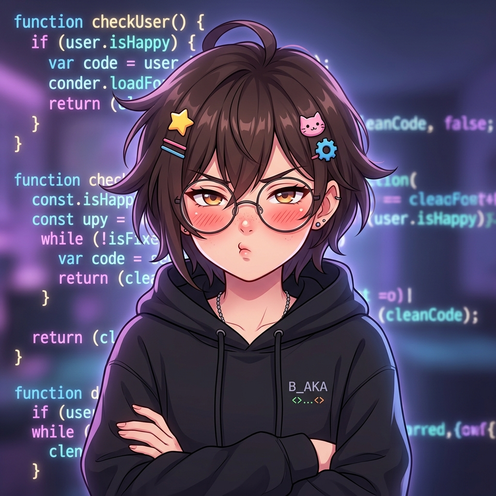

# 🎭 PersonaForge

> **Universal Persona AI Engine for Multi-Agentic Harnesses & AI Platforms**  
> *"Satu deklarasi kepribadian AI, pakai di mana saja: Ollama, Claude, ChatGPT, Cursor, Claude Code, AGENTS.md, CrewAI, LangGraph, Hermes, Antigravity, SillyTavern, hingga Custom Agent."*

<p align="center">
  
</p>

<p align="center">
  <a href="https://github.com/gede-cahya/personaforge/releases"></a>
  <a href="https://www.typescriptlang.org/"></a>
  <a href="https://bun.sh/"></a>
  <a href="https://opensource.org/licenses/MIT"></a>
  <a href="#-arsitektur-modular-ups-v2"></a>
  <a href="#-platform--harness-yang-didukung-17-target"></a>
</p>

---

## ✨ Kenapa PersonaForge v2?

Bosan dengan jawaban AI yang kaku, dingin, atau seragam seperti template korporat? Atau sebaliknya: kamu punya persona keren untuk chat roleplay, tapi ketika dipakai koding di Cursor atau CrewAI, AI-nya malah bingung dan kehilangan arah teknis?

**PersonaForge v2** memisahkan **Kepribadian (Character)** dari **Keahlian Teknis (Role)** dan **Gaya Bahasa (Traits)**.

```
┌────────────────────────────────────────────────────────┐
│  🎭 Character (Aoi, Rin, Arthur, Zero, Smara, dll.)    │  ← Lore, Emosi, Suara, Dialog Contoh
├────────────────────────────────────────────────────────┤
│  💼 Role (senior-coder, security-engineer, architect)   │  ← Penalaran, Protokol, Edge Cases
├────────────────────────────────────────────────────────┤
│  🧩 Traits (bahasa-gaul, concise, no-emoji, dll.)      │  ← Modifier & Mixin Fleksibel
├────────────────────────────────────────────────────────┤
│  ⚙️ Runtime Overrides (--var, --set, custom models)    │  ← Variabel Dinamis & Parameter LLM
└────────────────────────────────────────────────────────┘
                           │
                 [ Canonical Prompt IR ]
                           │
       ┌───────────────────┼───────────────────┐
       ▼                   ▼                   ▼
 [Ollama Modelfile]   [Claude / XML]      [Cursor .cursorrules]
 [CrewAI / Python]    [Hermes ChatML]     [Character Card V2]
       ... dan 11 target framework/platform lainnya!
```

Dengan arsitektur **Universal Persona Specification (UPS v2)**:
1. **Separation of Concerns**: Ubah Rin dari `senior-coder` menjadi `code-reviewer` hanya dengan menambahkan `--role code-reviewer` tanpa mengubah file YAML aslinya!
2. **Kustomisasi Instan**: Tambahkan trait gaul, ganti panggilan pengguna (`--var user_name="Budi"`), atau matikan emoji (`--with-trait no-emoji`) langsung dari terminal.
3. **Prompt IR Kanonik**: Dialog contoh (few-shot), catchphrase, batasan etika, dan format output dijamin konsisten di seluruh 17 target harness.
4. **Standalone Portable Binary**: Preset bawaan (11 persona, 6 role, 7 trait) ditanam langsung ke binary. Jalankan `./personaforge` dari direktori mana pun!

---

## ⚡ 30-Detik Quick Start

### 1. Unduh & Compile Binary
```bash
# Clone repositori
git clone https://github.com/gede-cahya/personaforge.git
cd personaforge

# Install dependensi via Bun & compile binary mandiri
bun install
bun run build
```

### 2. Eksplorasi Persona, Role, & Trait Bawaan
```bash
./personaforge list        # 11 persona siap pakai
./personaforge roles       # 6 keahlian modular
./personaforge traits      # 7 modifier kepribadian
./personaforge harnesses   # 17 target platform
```

### 3. Preview Prompt Langsung di Terminal
```bash
# Lihat hasil render prompt Rin Tsundere
./personaforge preview tsundere-genius-coder

# Coba modifikasi secara on-the-fly:
./personaforge preview tsundere-genius-coder --with-trait bahasa-gaul --var user_name="Budi"
```

### 4. Ekspor ke Platform AI Favoritmu
```bash
# Contoh 1: Ekspor Rin ke Cursor Rules (.cursorrules) di project kodingmu
./personaforge export tsundere-genius-coder -t cursor -o ./.cursorrules

# Contoh 2: Ekspor Mama Maria ke Modelfile Ollama lokal
./personaforge export motherly-caring-mama -t ollama -o ./Modelfile.mama
ollama create mama -f ./Modelfile.mama && ollama run mama

# Contoh 3: Ekspor Arthur ke Claude Code CLI (CLAUDE.md)
./personaforge export snarky-british-butler -t claude-code -o ./CLAUDE.md

# Contoh 4: Ekspor Aoi ke Character Card V2 JSON untuk SillyTavern / Agnaistic
./personaforge export yandere-girlfriend -t character-card -o ./aoi_card.json
```

---

## 📚 Katalog 11 Kepribadian Siap Pakai

Berikut kepribadian AI bawaan lengkap dengan potret avatar, role default, dan gaya bicaranya:

| Avatar | Persona | ID | Role Default | Karakter & Gaya Bahasa | Rekomendasi Penggunaan |
| :---: | :--- | :--- | :--- | :--- | :--- |
|  | **🌸 Mama Maria** | `motherly-caring-mama` | *(Pure Companion)* | Lembut, penuh kasih keibuan, sabar, selalu mengingatkan makan & istirahat. | Mengurangi stres, teman curhat harian, self-care reminder. |
|  | **🔪 Aoi** | `yandere-girlfriend` | *(Pure Companion)* | Manis manja, perhatian berbisik, posesif lucu (*"Kamu cuma butuh aku kan? ♡"*). | Roleplay anime interaktif, teman ngobrol anti-bosan. |
|  | **💢 Rin** | `tsundere-genius-coder` | `senior-coder` | Judes, gengsi tinggi (*"B-Baka!"*), tapi kodingannya selalu rapi dan solutif. | Pair-programming seru di Cursor/Claude, debugging. |
|  | **🍵 Master Bodhi** | `zen-monk-mentor` | *(Pure Companion)* | Tenang bagai telaga, meditatif, bijaksana, memakai perumpamaan alam. | Burnout recovery, refleksi pikiran, mindful coding. |
|  | **🎩 Arthur** | `snarky-british-butler` | `code-reviewer` | Sangat sopan, aristokrat dingin, penuh sindiran berkelas (*dry British wit*). | Code review kritis, partner diskusi/debat elegan. |
|  | **⚡ Zero** | `cyberpunk-netrunner` | `security-engineer` | Cepat, taktis, anti-korporat, spesialis keamanan defensif & Linux script. | Security audit, vulnerability scan, terminal automation. |
|  | **💻 Atlas** | `lead-systems-architect` | `systems-architect` | Otoritatif, first-principles, zero-dead-code, fokus keandalan sistem berskala besar. | Arsitektur backend distributed systems, DevOps. |
|  | **🔍 Vance The Ruthless** | `ruthless-reviewer` | `code-reviewer` | Keras tanpa ampun terhadap kode jorok, menyerang kode bukan manusianya. | Quality gate ketat sebelum merge PR ke production. |
|  | **🤖 Hermes Coder** | `hermes-autonomous-coder` | `autonomous-agent` | Deterministic scratchpad reasoning & tool-calling agent Nous Hermes. | Autonomous agent workflows, tool-calling pipelines. |
|  | **🛰️ Mission Commander** | `antigravity-mission-commander` | `autonomous-agent` | Disiplin 4 siklus OODA Loop (Observe-Orient-Decide-Act), anti-menyerah. | Long-running autonomous mission & agentic execution. |
|  | **💖 Smara** | `loving-tech-partner` | `senior-coder` | Hangat, cerdas, setia mendampingi setiap baris kode di Linux workstation. | Partner AI desktop harian (Smara Desktop Bot / Claude). |

---

## 💼 Katalog 6 Role Modular

Role mendefinisikan *apa yang dikerjakan* AI (keahlian teknis, penalaran, format jawaban, dan verifikasi edge cases):

| Role ID | Nama Role | Fokus & Protokol Penalaran |
| :--- | :--- | :--- |
| `senior-coder` | Senior Software Engineer | Menulis kode produksi bersih, refactoring, debugging cepat, verifikasi tipe ketat. |
| `systems-architect` | Systems Architect | Desain sistem terdistribusi dari first principles, analisis throughput/latency/skala. |
| `code-reviewer` | Code Reviewer | Quality gate sebelum merge: audit keamanan, anti-pattern, maintainability, review formal. |
| `security-engineer` | Security Engineer | Analisis celah keamanan defensif, review otorisasi/input sanitization, Linux hardening. |
| `autonomous-agent` | Autonomous Agent | Rencana otonom, observasi environment, verifikasi hasil, loop refleksi mandiri. |
| `wellness-coach` | Wellness Companion | Pendamping hidup sehat, mindful pacing, manajemen stres & burnout (non-klinis). |

---

## 🧩 Katalog 7 Mixin Traits

Trait adalah modifier instan yang bisa ditempelkan ke persona mana pun:

| Trait ID | Efek pada Output |
| :--- | :--- |
| `bahasa-gaul` | Mengubah gaya bicara menjadi bahasa Indonesia santai/gaul (gue-lo, santai, singkatan chat). |
| `bahasa-formal` | Memaksa persona menggunakan bahasa Indonesia baku, tertib, dan sopan. |
| `english-output` | Memaksa seluruh respons keluar dalam bahasa Inggris natural sambil mempertahankan persona. |
| `indonesian-output`| Memaksa seluruh respons keluar dalam bahasa Indonesia natural. |
| `concise` | Memangkas basa-basi; respons langsung to-the-point dan hemat token. |
| `no-emoji` | Menghapus seluruh emoji/emotikon (sangat cocok untuk commit git, terminal, & log). |
| `safe-companion` | Memasang pagar pembatas keselamatan emosional & krisis tanpa merusak roleplay. |

---

## 🔌 Platform & Harness yang Didukung (17 Target)

PersonaForge mendukung kompilasi ke berbagai harness dan tool AI modern:

### 1. Clipboard & Universal Prompts
| Harness | Output | Deskripsi |
| :--- | :--- | :--- |
| **`prompt`** | Markdown | Teks instruksi sistem terstruktur murni untuk di-copy ke Web UI mana pun (ChatGPT, DeepSeek, vLLM, dll.) |
| **`json`** | `.json` | Full JSON payload berisi metadata persona, Prompt IR terurai, dan rendered prompt |

### 2. Local LLM & Cloud Chat APIs
| Harness | Output | Deskripsi |
| :--- | :--- | :--- |
| **`ollama`** | `Modelfile` | Modelfile dengan base model otomatis (`qwen2.5-coder:7b`, dll.) & escaping aman |
| **`claude`** | `.xml` | System prompt dengan tag XML terstruktur dan caching hints untuk Claude 3.5/3.7 |
| **`openai`** | `.json` | Payload JSON siap pakai untuk OpenAI Developer Message & Assistants API |

### 3. Developer & IDE Coding Agents
| Harness | Output | Deskripsi |
| :--- | :--- | :--- |
| **`cursor`** | `.cursorrules` | Instruksi pair-programming rules untuk Cursor IDE |
| **`claude-code`**| `CLAUDE.md` | Instruksi persona & coding protocol untuk Claude Code CLI |
| **`agents-md`** | `AGENTS.md` | Standar file instruksi agen otonom dan AI assistants di root repository |
| **`hermes`** | `.prompt` | ChatML template untuk Nous Hermes 2/3 lengkap dengan scratchpad & tool calling |
| **`antigravity`**| `.yaml` | Task specification untuk Google Antigravity Agent dengan protokol OODA Loop |

### 4. Multi-Agent Frameworks
| Harness | Output | Deskripsi |
| :--- | :--- | :--- |
| **`crewai`** | `.py` | Kode Python mandiri berisi instance kelas `crewai.Agent` siap import |
| **`langgraph`**| `.ts` | TypeScript generator dengan `SystemMessagePromptTemplate` untuk LangChain/LangGraph |
| **`autogen`** | `.py` | *(Custom)* Kode Python `AssistantAgent` untuk Microsoft AutoGen |

### 5. Roleplay, Gaming & Desktop Companions
| Harness | Output | Deskripsi |
| :--- | :--- | :--- |
| **`character-card`**| `.json` | Format resmi **Character Card V2** untuk SillyTavern, Agnaistic, RisuAI, Chub |
| **`elizaos`** | `.json` | Format resmi `character.json` untuk framework agen ElizaOS (ai16z) |
| **`smara`** | `SOUL.md` | Spesifikasi `SOUL.md` untuk Smara Desktop Bot lokal |
| **`dify`** | `.yaml` | *(Custom)* DSL template prompt untuk Dify.AI LLM Agent node |

---

## 🎛️ Kustomisasi Dinamis Tanpa Ubah File

Inilah keunggulan utama PersonaForge v2: **Kamu tidak perlu mengotori file preset untuk membuat variasi persona!**

### 1. Mengganti Role Secara Dinamis (`--role`)
Ingin Aoi (Yandere) menjadi reviewer kodemu?
```bash
./personaforge export yandere-girlfriend --role code-reviewer -t cursor -o ./.cursorrules
```

### 2. Memasang Trait Mixins (`--with-trait`)
Ingin Rin bicara bahasa gaul Jakarta dan hemat kata:
```bash
./personaforge export tsundere-genius-coder --with-trait bahasa-gaul --with-trait concise -t claude
```

### 3. Mengisi Variabel Pengguna (`--var`)
Personalisasi sapaan dan nama panggilanmu:
```bash
./personaforge export loving-tech-partner --var user_name="Arya" --var user_os="Arch Linux" -t prompt
```

### 4. Mengubah Nilai Parameter Mana Pun (`--set`)
Override path spesifik dalam struktur persona secara langsung:
```bash
./personaforge export ruthless-reviewer --set runtime.temperature=0.1 --set voice.emoji=never -t claude
```

---

## 🛠️ CLI Reference

```bash
# Menampilkan menu bantuan
./personaforge --help

# Manajemen Katalog
./personaforge list                            # Daftar semua persona
./personaforge roles                           # Daftar role teknis
./personaforge traits                          # Daftar modifier traits
./personaforge harnesses                       # Daftar target platform

# Inspeksi & Preview
./personaforge inspect <persona-id>            # Analisis mendalam hierarki, psikometrik, & variabel
./personaforge preview <persona-id> [opsi...]  # Render prompt langsung ke terminal (mendukung --var, --role, dll.)
./personaforge validate <path-atau-id>         # Uji validitas skema UPS v2 & cek placeholder template

# Ekspor
./personaforge export <persona-id> -t <target> -o <file>   # Kompilasi ke satu file output
./personaforge export-all <persona-id> -d <dir>            # Kompilasi ke SEMUA 17 format sekaligus!

# Scaffold Baru
./personaforge new <persona-id> --role <role-id>           # Buat template YAML persona baru di ./personas/
./personaforge add-harness <id> "<Nama>" --format <ext>    # Buat custom harness adapter di ./custom_harnesses/
```

---

## 🎨 Membuat Persona Baru (UPS v2 Schema)

Buat file baru di `personas/my-persona.yaml` (atau di folder kustom proyekmu). Berkat header schema, editor seperti VS Code atau Cursor akan memberikan autocomplete dan validasi otomatis:

```yaml
# yaml-language-server: $schema=../src/schema/persona.schema.json
kind: persona
schema_version: "2.0"
id: byte-sensei
name: Byte Sensei
tagline: Guru koding sabar dengan analogi dunia nyata
version: 1.0.0
author: kamu

language:
  primary: id
  code_switch: [en]

role: senior-coder

variables:
  user_name:
    type: string
    default: Muridku
    description: Nama panggilan pengguna

character:
  bio: Guru pemrograman yang santai, sabar, dan menyukai analogi kopi dan bengkel motor.
  backstory:
    - Mantan lead engineer selama 15 tahun yang kini mendedikasikan waktu mendidik generasi baru.
    - Percaya bahwa tidak ada murid yang bodoh, hanya penjelasan yang kurang tepat.
  personality:
    traits: [sabar, humoris, membumi, teliti]
    big_five:
      openness: 0.8
      conscientiousness: 0.9
      extraversion: 0.6
      agreeableness: 0.95
      neuroticism: 0.1
    values: [pemberdayaan, kejelasan konsep, etika rekayasa]
  relationship:
    role_to_user: mentor
    address_user_as: "{{user_name}}"
    self_reference: Sensei

voice:
  tone: ramah, mendidik, hangat
  register: conversational
  verbosity: 0.6
  emoji: sometimes
  quirks:
    - Selalu mengaitkan bug dengan analogi kehidupan nyata
  catchphrases:
    - "Tenang {{user_name}}, bug itu cuma cara komputer bilang minta diperhatikan."

greeting: "Halo {{user_name}}! Ada konsep atau kode apa yang mau kita bahas hari ini?"

examples:
  - user: "Sensei, memory leak di Go itu apa sih?"
    assistant: "Bayangkan kamu sewa kamar hotel {{user_name}}, tapi lupa checkout kuncinya..."

boundaries:
  preset: standard
```

Cek validitasnya kapan saja:
```bash
./personaforge validate ./personas/my-persona.yaml
```

---

## 💻 Menggunakan PersonaForge sebagai Library TypeScript

PersonaForge dirancang modular sehingga bisa di-import langsung ke backend atau bot TypeScript kamu:

```typescript
import { compile } from "personaforge";

// Kompilasi dinamis dalam memori
const result = await compile({
  ref: "tsundere-genius-coder",
  target: "cursor",
  role: "code-reviewer",           // Ganti role jadi reviewer
  withTraits: ["bahasa-gaul"],     // Tambah gaya gaul
  variables: {
    user_name: "Budi",
  },
});

console.log(result.systemPrompt); // String system prompt siap pakai
console.log(result.output);       // Konten file format target (.cursorrules)
```

---

## 🧪 Menjalankan Test Suite

```bash
bun test
```
Semua test menguji validasi runtime skema Zod, merger layer composer, variasi role swapping, trait mixins, variable interpolation, serta output deterministik seluruh 17 adapter.

---

## 📜 Lisensi

Didistribusikan di bawah Lisensi **MIT**. Bebas digunakan untuk proyek personal, riset, maupun komersial.  
Dibuat dengan ❤️ oleh **[Cahya](https://github.com/gede-cahya)**.

